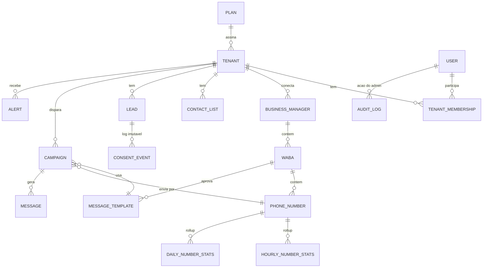

# Modelo de dados

Os tipos em `packages/core/src/domain/` **são** o contrato. Cada `interface` vira uma tabela no Postgres
(Prisma), cada union de strings vira um `enum` ou `text` com `CHECK`. As telas nunca leem tabelas:
leem a interface `DataSource` (`packages/core/src/data/datasource.ts`), hoje implementada em memória
(`data/mock`) e depois por uma `PostgresDataSource` com a mesma assinatura.

## Entidades → tabelas

| Tipo TS (arquivo) | Tabela | Notas |
|---|---|---|
| `Plan` (tenant.ts) | `plans` | Limites mensais, números, assentos, contatos. |
| `Tenant` (tenant.ts) | `tenants` | `limitsOverride` em `jsonb`. `sendingEnabled` = kill switch do admin. Branding white-label embutido. |
| `User`, `TenantMembership` (tenant.ts) | `users`, `tenant_memberships` | `platformRole` (superadmin/support) separado do papel no tenant. |
| `BusinessManager` (meta.ts) | `business_managers` | Limite de 24 h (`messagingLimitTier`) mora aqui: desde out/2025 é do portfólio, compartilhado entre os números. |
| `WhatsAppBusinessAccount` (meta.ts) | `wabas` | `webhookSubscribed` — sem isso não recebemos status nem opt-outs. |
| `PhoneNumber` (meta.ts) | `phone_numbers` | Enums em CAIXA ALTA espelham a Graph API (gravamos o que a Meta devolve). |
| `MessageTemplate` (template.ts) | `message_templates` | `content` em `jsonb`. MARKETING exige botão de descadastro (regra nossa). |
| `Campaign` (campaign.ts) | `campaigns` | `stats` é cache dos workers; a verdade está em `messages`. Guardrails pausam sozinhos. |
| `Lead`, `ContactList` (lead.ts) | `leads`, `contact_lists`, `contact_list_members` | `UNIQUE (tenant_id, phone)`. Dois eixos: `stage` (funil) e `consent` (LGPD). |
| `ConsentEvent` (lead.ts) | `consent_events` | **Append-only.** `Lead.consent` é projeção do último evento. |
| `Message` (message.ts) | `messages` | Maior tabela: particionar por mês, `UNIQUE (wamid)`, índice `(tenant_id, created_at)`. |
| `HourlyNumberStats`, `DailyNumberStats` (metrics.ts) | `hourly_number_stats`, `daily_number_stats` | Rollups. Dashboards leem daqui, nunca `COUNT(*)` em `messages`. |
| `Alert` (infra.ts) | `alerts` | Abertos/resolvidos por `deriveAlerts()` (rules/alerts.ts), as mesmas regras no mock e no worker. |
| `AuditLogEntry` (infra.ts) | `audit_log` | Append-only. Toda ação do admin que muda estado de cliente. |
| `ServiceHealth` (infra.ts) | — | Vem do monitoramento, não do banco. |

## Do doc de arquitetura para o código

O doc do projeto lista um modelo mínimo em português. O código usa nomes em inglês (e os valores
da Meta onde existem) para que a sincronização com a Graph API não precise traduzir. Equivalências:

| Doc | Código |
|---|---|
| Tenant `nome, slug, plano, status` | `Tenant.tradeName, slug, planId, status` |
| User `papel ADMIN \| CLIENTE` | `User.platformRole` + `TenantMembership.role` |
| BM `status ativa \| restrita \| banida` | `BusinessManager.verificationStatus` + `connectionStatus` (+ status dos números) |
| Numero `status`, `qualidade alta\|media\|baixa` | `PhoneNumber.status` (Graph API), `qualityRating GREEN\|YELLOW\|RED` |
| Numero `tier` | `BusinessManager.messagingLimitTier` (o limite é do portfólio) |
| Template `aprovado\|pendente\|rejeitado` | `MessageTemplate.status` (+ `PAUSED`, `DISABLED`, `IN_APPEAL`) |
| Campanha `rascunho … pausado` | `Campaign.status` + `pauseReason` |
| Lead `novo\|respondido\|interessado\|invalido` | `Lead.stage` |
| Lead `opt_out` | `Lead.consent.status = "opted_out"` (eixo separado, vence o estágio) |
| Fluxo | ainda não modelado — fica com o chat "Disparos & Fluxos" |

Fora do modelo de propósito: status "aquecendo" de BM/número. Rampa de volume, quando existir, é
um limite que **nós** impomos (throttle da campanha), não uma técnica para mudar como a Meta
enxerga o número.

## Multi-tenancy

Toda entidade de cliente tem `tenantId`. Admin passa filtro opcional; o portal recebe o `tenantId`
da sessão. Na `PostgresDataSource`, Row Level Security por `tenant_id` é a segunda barreira.
IDs têm marca de tipo (`TenantId`, `PhoneNumberId`…) e prefixo (`tnt_`, `pn_`…), gerados como ULID.

## Postgres hoje (Neon)

**Schema único:** `apps/admin/prisma/schema.prisma` (tabelas `cliente`, `bm`, `numero`, `template`,
estados em pt-BR do doc 04). Não existe outro schema; evoluções entram nesse arquivo.

**Como o núcleo lê:** `createPostgresDataSource(store)` em `packages/core/src/data/postgres/`. O app
injeta um `ContingencyStore` (uma linha de Prisma por tabela, ver `apps/admin/lib/datasource.ts`),
então o `@eco/core` não depende do cliente gerado. A tradução pt-BR → domínio fica só em `mappers.ts`:

| Banco | Domínio |
|---|---|
| `cliente.status` ativo / trial / inadimplente / suspenso / cancelado | `Tenant.status` active / trial / past_due / suspended / churned |
| `cliente.plano` starter / pro / scale / enterprise | plano `start` / `growth` / `scale` / `enterprise` (`data/plans.ts`) |
| `bm.status` em_verificacao / escalonando / ativa | `accountStatus = active` |
| `bm.status` restrita / banida | `accountStatus = restricted / banned` (alerta crítico) |
| `bm.verificacao` pendente / verificada / recusada | `verificationStatus` pending / verified / rejected |
| `bm.nivelLimite` 250 / 1000 / 10000 / 100000 / 0 | `TIER_250` / `TIER_2K` / `TIER_10K` / `TIER_100K` / `TIER_UNLIMITED` |
| `numero.status` pendente / ativo / limitado / restrito / banido / desconectado | `PENDING` / `CONNECTED` / `RATE_LIMITED` / `RESTRICTED` / `BANNED` / `DISCONNECTED` |
| `numero.status` aquecendo | `CONNECTED` (rampa é throttle nosso, não estado da Meta) |
| `numero.qualidade` alta / media / baixa / sem_avaliacao | `GREEN` / `YELLOW` / `RED` / `UNKNOWN` |
| `template.categoria`, `template.status` | `MARKETING`/`UTILITY`/`AUTHENTICATION`, `APPROVED`/`PENDING`/`REJECTED`/`PAUSED`/`DISABLED` |

Registros sem vínculo (número sem BM, BM sem cliente) aparecem sob um tenant/BM sintéticos
("Sem cliente vinculado", "Sem BM vinculada") para não sumirem; não contam nos indicadores e não
geram alertas de BM.

**Ainda não está no banco** (volta vazio, nunca inventado): WABAs, campanhas, leads/consentimento,
mensagens e rollups horários/diários. O uso do limite 24 h da BM é estimado por `numero.enviadasHoje`
até existirem rollups com destinatários únicos.

**Seleção:** `DATA_SOURCE=postgres|mock`. Sem a variável, o admin usa Postgres quando há `DATABASE_URL`.
